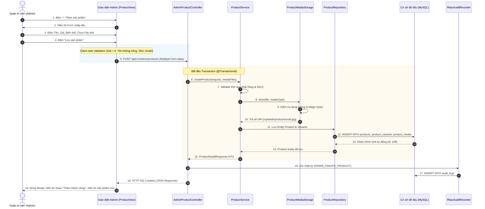

# TÀI LIỆU ĐẶC TẢ CHI TIẾT USE CASE (USE CASE SPECIFICATION)
## USE CASE: THÊM SẢN PHẨM MỚI (CREATE PRODUCT)

> **Hệ thống:** Website Thương mại Điện tử Nội thất Nhà Xinh  
> **Phân hệ:** Quản trị Danh mục & Kho hàng (Admin Catalog & Inventory Portal)  
> **Mã Use Case:** `UC_ADMIN_PROD_01`  
> **Tiêu chuẩn tài liệu:** RUP / IEEE 830 / Cockburn Software Engineering Standard  
> **Phiên bản:** 2.0 (Khớp 100% kiến trúc Spring Boot REST API + React SPA + MySQL)  

---

## 1. THÔNG TIN ĐỊNH DANH USE CASE (IDENTIFICATION)

| Thuộc tính | Chi tiết đặc tả |
| :--- | :--- |
| **Tên Use Case** | **Thêm mới sản phẩm (Create / Add New Product)** |
| **Mã định danh** | `UC_ADMIN_PROD_01` (thuộc nhóm Use Case cha: *Quản lý sản phẩm*) |
| **Mục đích (Goal)** | Cung cấp cho Quản trị viên/Nhân viên giao diện và API chuẩn xác để nhập liệu sản phẩm nội thất mới, cấu hình danh mục, thương hiệu, giá bán, các biến thể (variants), quản lý tồn kho và tải lên các tệp media (ảnh đa góc nhìn, mô hình 3D AR) đưa vào hệ thống kinh doanh. |
| **Tác nhân chính (Primary Actor)** | **Quản trị viên (Admin)** / **Nhân viên quản lý sản phẩm (Staff)** có quyền `products.create`. |
| **Tác nhân phụ (Supporting Actors)** | - **Hệ thống lưu trữ Media (ProductMediaStorage):** Lưu trữ file ảnh vật lý vào thư mục `/uploads/products/`.<br>- **Hệ thống Cơ sở dữ liệu (MySQL Database):** Đảm bảo tính toàn vẹn dữ liệu qua Transaction.<br>- **Hệ thống Kiểm toán (RbacAuditRecorder):** Ghi log audit hành vi quản trị viên. |
| **Mức độ ưu tiên (Priority)** | **Critical** (Chức năng cốt lõi tạo lập dữ liệu danh mục). |
| **Kích hoạt (Trigger)** | Người dùng chọn tab *"Sản phẩm"* trong Admin Portal và bấm nút *"+ Thêm sản phẩm"*. |

---

## 2. TIỀN ĐIỀU KIỆN (PRECONDITIONS)

1. Tác nhân (Actor) đã đăng nhập thành công vào hệ sinh thái Quản trị (`/admin`).
2. Tài khoản của Actor sở hữu vai trò `ROLE_ADMIN` hoặc được phân quyền cụ thể `products.create` (kiểm tra qua `PermissionGate` và Spring Security).
3. Hệ thống Danh mục (`Category`) đã có sẵn ít nhất một danh mục đang kích hoạt (`ACTIVE`) để sản phẩm có thể liên kết phân loại.
4. Hệ thống máy chủ còn đủ dung lượng ổ đĩa khả dụng để tiếp nhận các tệp ảnh và mô hình 3D.

---

## 3. HẬU ĐIỀU KIỆN (POSTCONDITIONS)

### 3.1. Hậu điều kiện Thành công (Success Guarantee)
* Bản ghi sản phẩm mới được ghi vào bảng `products` với ID tự sinh, trạng thái `ACTIVE` (hoặc `DRAFT`).
* Đường dẫn thân thiện (`slug`) được sinh duy nhất trong toàn hệ thống.
* Ít nhất 1 bản ghi biến thể được ghi vào bảng `product_variants` với mã `sku` không trùng lặp, liên kết giá bán và số lượng tồn kho ban đầu.
* Tất cả tệp tải lên (nếu có) được kiểm tra header hợp lệ, mã hóa UUID an toàn, ghi vào thư mục đĩa `/uploads/products/` và lưu URL tương ứng trong bảng `product_media`.
* Bảng liên kết `product_categories` được cập nhật chính xác với các danh mục được gán.
* Ghi nhận một sự kiện kiểm toán (`audit_logs`) với hành động `ADMIN_CREATE_PRODUCT`.
* Bảng quản lý sản phẩm phía giao diện Admin được cập nhật lập tức đưa sản phẩm mới lên đầu trang. Khách hàng ngoài trang web có thể tìm kiếm, xem chi tiết và thêm vào giỏ hàng ngay lập tức (nếu `status = ACTIVE`).

### 3.2. Hậu điều kiện Thất bại (Minimal Guarantee)
* Toàn bộ thao tác cơ sở dữ liệu được Rollback 100% nhờ `@Transactional` của Spring Boot, không sinh ra dữ liệu rác hay bản ghi mồ côi (orphaned records).
* Nếu có lỗi trong quá trình lưu dữ liệu, cơ chế `TransactionSynchronization` kích hoạt tự động xóa các file media vừa ghi tạm trên ổ đĩa thông qua `deleteQuietly()`.
* Dữ liệu người dùng đã nhập trên form không bị xóa mất, hệ thống hiển thị thông báo lỗi màu đỏ rõ ràng tại vị trí xảy ra lỗi (ví dụ: *"Mã SKU đã tồn tại"*, *"Ảnh vượt quá 10MB"*).

---

## 4. LUỒNG SỰ KIỆN CHÍNH (MAIN SUCCESS SCENARIO - HAPPY PATH)

```
[Actor: Admin / Staff]                              [System: Frontend & Backend API]
        |                                                           |
   (1)  |--- Nhấn nút "+ Thêm sản phẩm" --------------------------->|
        |<-- Hiển thị Form Thêm sản phẩm (Modal/Drawer) ------------| (2)
        |                                                           |
   (3)  |--- Nhập Tên sản phẩm ("Sofa Băng Victoria...") --------->|
        |<-- Tự động sinh Slug ("sofa-bang-victoria...") -----------| (4)
        |                                                           |
   (5)  |--- Chọn Danh mục, Thương hiệu, Mô tả & Kích thước ------->|
   (6)  |--- Thiết lập Giá bán, Giá so sánh & Tồn kho -------------->|
   (7)  |--- Thêm các Biến thể (Màu sắc, Chất liệu, SKU) ---------->|
   (8)  |--- Tải lên File ảnh / Mô hình 3D (hoặc dán URL) --------->|
   (9)  |--- Bấm nút "Lưu sản phẩm" -------------------------------->|
        |                                                           |
        |                                                           | (10) Client Validation hợp lệ
        |                                                           | (11) Gửi POST /api/v1/admin/products
        |                                                           | (12) Server Transaction:
        |                                                           |      - Validate tính duy nhất (SKU, Slug)
        |                                                           |      - Upload & Lưu Media
        |                                                           |      - Insert Product, Variants, Categories
        |                                                           |      - Ghi Audit Log
        |<-- Phản hồi 201 Created kèm Chi tiết sản phẩm ------------| (13)
        |<-- Đóng modal, hiển thị Toast "Thêm thành công!" --------| (14)
        |<-- Cập nhật danh sách bảng sản phẩm ----------------------| (15)
```

### Các bước tương tác chi tiết:

| Bước | Hành động của Tác nhân (Actor Action) | Phản hồi của Hệ thống (System Response) |
| :---: | :--- | :--- |
| **1** | Actor truy cập trang Quản lý Sản phẩm (`/admin` ➔ Tab *Sản phẩm*) và nhấn nút **"+ Thêm sản phẩm"**. | Hệ thống mở Modal/Drawer chứa Form tạo mới sản phẩm với các tab/phần rõ ràng: *Thông tin chung*, *Giá & Tồn kho*, *Biến thể (Variants)*, *Hình ảnh & 3D Media*. |
| **2** | Actor nhập **Tên sản phẩm** (VD: *"Sofa Vải Bouclé Nét Đương Đại"*). | Client tự động chuẩn hóa tiếng Việt không dấu, thay khoảng trắng bằng dấu `-` để điền tự động vào ô **Đường dẫn (Slug)**: `sofa-vai-boucle-net-duong-dai`. |
| **3** | Actor chọn **Danh mục** (VD: *Phòng khách*, *Sofa*) và **Thương hiệu** tương ứng. | Hệ thống nạp danh mục và kiểm tra tính hợp lệ của phân cấp danh mục cha - con. |
| **4** | Actor nhập **Mô tả ngắn**, **Mô tả chi tiết** (hỗ trợ định dạng văn bản giàu) và **Thông số kỹ thuật** (Chất liệu, kích thước WxHxD mm, trọng lượng). | Hệ thống hiển thị bộ đếm ký tự và cập nhật trường dữ liệu tương ứng. |
| **5** | Actor thiết lập **Giá bán mặc định**, **Giá so sánh (Giá niêm yết cũ)** và **Số lượng tồn kho ban đầu**. | Client kiểm tra logic: Giá bán phải lớn hơn 0 và nhỏ hơn hoặc bằng giá so sánh nếu có giảm giá. |
| **6** | *(Tùy chọn)* Actor nhấn *"Thêm biến thể"* để cấu hình danh sách phiên bản sản phẩm (Màu sắc, Size, SKU riêng biệt từng phân loại). | Hệ thống mở sub-modal cấu hình biến thể, sinh mã SKU gợi ý theo cú pháp chuẩn. |
| **7** | Actor kéo-thả hoặc chọn tệp ảnh thực tế từ máy tính (PNG/JPG/WEBP) hoặc dán link ảnh trực tuyến, chọn ảnh đại diện chính (Primary Media). | Client hiển thị xem trước thumbnail tức thì và gán nhãn thứ tự sắp xếp (`sortOrder`). |
| **8** | Actor chọn trạng thái: **"Đang bán (ACTIVE)"** hoặc **"Bản nháp (DRAFT)"** và nhấn nút **"Lưu sản phẩm"**. | Hệ thống tiến hành xác thực toàn diện dữ liệu đầu vào tại Client. |
| **9** | Client đóng gói Request: Nếu có upload file thì đóng gói dạng `multipart/form-data`, nếu chỉ dùng URL thì đóng gói `application/json`. Gửi yêu cầu HTTP `POST /api/v1/admin/products`. | Máy chủ Spring Boot tiếp nhận Request, xác thực phân quyền qua token/cookie JSESSIONID. |
| **10** | — | **Xử lý phía Server (Backend Pipeline):**<br>1. Kiểm tra tính duy nhất của mã `slug` và danh sách các mã `sku` biến thể.<br>2. Kiểm tra tồn tại của các `categoryId` trong database.<br>3. Kiểm tra tính hợp lệ của header file media (chống giả mạo đuôi file).<br>4. Lưu file vào ổ cứng `/uploads/products/[UUID].[ext]`.<br>5. Lưu bản ghi Product, ProductVariant, ProductMedia, ProductCategory.<br>6. Ghi Audit log: `ADMIN_CREATE_PRODUCT`. |
| **11** | — | Server trả về mã phản hồi `201 Created` kèm theo dữ liệu `ProductDetailResponse` hoàn chỉnh và Header `Location: /api/v1/admin/products/{id}`. |
| **12** | Actor nhận thông báo thành công. | Giao diện tự động đóng Modal, hiển thị Toast xanh: *"Thêm mới sản phẩm thành công!"*, thêm ngay sản phẩm mới lên đầu danh sách và làm mới bộ đếm sản phẩm. |

---

## 5. CÁC LUỒNG THAY THẾ (ALTERNATIVE FLOWS)

### Luồng A1: Sản phẩm đơn thể (Không phân loại màu/size - Single Variant)
* **Điều kiện:** Actor không kích hoạt danh sách nhiều biến thể mà chỉ nhập thông tin ở phần Giá & Tồn kho chung.
* **Xử lý:** Hệ thống tự động tạo 1 biến thể mặc định (Default Variant) mang tên của chính sản phẩm, tự động sinh mã SKU theo cú pháp: `[SLUG_RÚT_GỌN]-[MÃ_NGẪU_NHIÊN]` và gán giá bán cùng tồn kho đã nhập.

### Luồng A2: Sản phẩm là Hàng Đặt Trước (Pre-order Product)
* **Điều kiện:** Sản phẩm chưa có sẵn trong kho (`initialStock = 0`) nhưng là hàng sản xuất theo đơn hoặc nhập khẩu theo yêu cầu.
* **Xử lý:**
  1. Actor tích chọn cờ **"Cho phép đặt hàng trước (Pre-order)"**.
  2. Actor nhập thời gian dự kiến giao hàng (VD: *"15 - 20 ngày chế tác"*).
  3. Hệ thống lưu sản phẩm với tồn kho 0, nhưng cờ `allowPreorder = true`.
  4. Ngoài trang bán lẻ, sản phẩm không hiển thị nút "Hết hàng" mà hiển thị nút **"Đặt hàng trước"** kèm cam kết thời gian giao.

### Luồng A3: Sử dụng ảnh từ URL trực tuyến (Không upload file)
* **Điều kiện:** Actor có sẵn link ảnh từ CDN hoặc Unsplash / nhà cung cấp.
* **Xử lý:** Actor dán trực tiếp URL vào ô link ảnh. Hệ thống không thực hiện upload file vật lý, chỉ lưu chuỗi URL vào trường `mediaUrl` của bảng `product_media`.

### Luồng A4: Tải lên Mô hình 3D AR (Augmented Reality)
* **Điều kiện:** Sản phẩm có tệp 3D định dạng `.glb` hoặc `.gltf` để khách hàng xem thực tế ảo qua điện thoại.
* **Xử lý:** Actor chọn tệp 3D (tối đa 100MB). Hệ thống nhận diện `mediaType = "MODEL_3D"`, lưu trữ và gắn cờ để frontend kích hoạt tính năng xoay 3D / AR khi xem chi tiết sản phẩm.

---

## 6. CÁC LUỒNG NGOẠI LỆ / XỬ LÝ LỖI (EXCEPTION FLOWS)

### Luồng E1: Người dùng không có quyền (403 Forbidden)
* **Nguyên nhân:** Nhân viên đăng nhập không có quyền `products.create`.
* **Phản hồi:** Server trả về HTTP `403 Forbidden` (`{"code": "AUTH_FORBIDDEN", "message": "Bạn không có quyền thực hiện thao tác này."}`). Giao diện hiển thị cảnh báo đỏ và ghi nhận log cảnh báo vi phạm quyền.

### Luồng E2: Trùng mã SKU (Duplicate SKU)
* **Nguyên nhân:** Mã SKU của một biến thể đã tồn tại trong cơ sở dữ liệu.
* **Phản hồi:** Server phát hiện qua `productVariantRepository.findBySku()` và ném lỗi `IllegalArgumentException("Mã SKU [SKU_CODE] đã tồn tại")`.
* **Xử lý UI:** Server trả về HTTP `400 Bad Request`. Form không bị đóng, trường nhập SKU vi phạm bị bôi đỏ kèm thông báo lỗi cụ thể để Actor sửa lại mã SKU.

### Luồng E3: Trùng đường dẫn Slug (Duplicate Slug)
* **Nguyên nhân:** Tên sản phẩm tạo ra slug trùng lặp với sản phẩm đã có.
* **Xử lý tự động:** Hệ thống tự động thêm hậu tố số tăng dần (ví dụ: `sofa-victoria-1`, `sofa-victoria-2`) để đảm bảo tính duy nhất mà không làm gián đoạn luồng nhập liệu của Actor.

### Luồng E4: Tệp media vượt quá kích thước hoặc sai định dạng
* **Nguyên nhân:** File ảnh vượt quá 10MB, hoặc cố tình tải lên file thực thi `.exe`, `.bat` giả mạo đuôi `.jpg`.
* **Phản hồi:** `ProductMediaStorage.validateUpload()` đọc 12 bytes header đầu tiên của tệp; nếu không khớp signature hợp lệ hoặc vượt quá dung lượng, hệ thống ném ngoại lệ: *"File media không đúng định dạng hoặc vượt quá dung lượng cho phép"*.

### Luồng E5: Dữ liệu giá bán hoặc số lượng không hợp lệ
* **Nguyên nhân:** Actor nhập giá bán âm (`< 0`), giá khuyến mãi lớn hơn giá bán, hoặc tồn kho ban đầu là số âm.
* **Phản hồi:** Form Client chặn submit ngay lập tức nhờ HTML5 / Zod / React Hook Form validation. Nếu gửi trực tiếp qua API, Jakarta Bean Validation (`@PositiveOrZero`, `@DecimalMin`) chặn lại và trả về lỗi `400 Validation Error`.

### Luồng E6: Lỗi hệ thống trong quá trình lưu dữ liệu (Database Exception)
* **Nguyên nhân:** Mất kết nối database hoặc deadlock trong transaction.
* **Phản hồi:** Spring Transaction tự động rollback toàn bộ dữ liệu. `ProductMediaStorage` xóa ngay lập tức các file vừa copy vào đĩa để tránh tồn đọng file rác. Client hiển thị thông báo: *"Hệ thống bận hoặc xảy ra lỗi máy chủ. Dữ liệu chưa được lưu, vui lòng thử lại sau giây lát."*

---

## 7. CÁC QUY TẮC NGHIỆP VỤ (BUSINESS RULES - BR)

| Mã BR | Tên quy tắc nghiệp vụ | Nội dung quy tắc chi tiết |
| :---: | :--- | :--- |
| **BR-01** | **Quy tắc sinh Slug SEO** | Slug bắt buộc chỉ chứa ký tự chữ thường (`a-z`), số (`0-9`) và dấu gạch nối (`-`), không chứa ký tự đặc biệt hay khoảng trắng, độ dài tối đa 260 ký tự. |
| **BR-02** | **Tính duy nhất của SKU** | Mỗi mã SKU trong toàn bộ hệ thống phải là duy nhất trên phạm vi toàn cục (Global Unique), độ dài tối đa 100 ký tự. |
| **BR-03** | **Logic Giá bán & Khuyến mãi** | `0 <= costPrice <= price <= compareAtPrice`. Nếu có áp dụng giảm giá, phần trăm giảm giá hiển thị được tính theo công thức: $\text{Discount} = \frac{\text{compareAtPrice} - \text{price}}{\text{compareAtPrice}} \times 100\%$. |
| **BR-04** | **Quản lý Tồn kho & Đặt trước** | Tồn kho ban đầu `initialStock >= 0`. Nếu `initialStock == 0` và cờ `allowPreorder == false`, sản phẩm ngoài giao diện được chuyển sang trạng thái "Hết hàng". Nếu `allowPreorder == true`, cho phép khách đặt cọc bình thường. |
| **BR-05** | **Giới hạn Media an toàn** | Tệp ảnh (JPG, PNG, WebP, GIF, SVG) tối đa 10MB/tệp. Tệp 3D (GLB, GLTF) tối đa 100MB/tệp. Bắt buộc kiểm tra magic bytes của tệp, không tin tưởng phần mở rộng của file client gửi lên. |
| **BR-06** | **Ảnh chính mặc định** | Mỗi sản phẩm phải có ít nhất 1 ảnh làm đại diện chính (`isPrimary = true`, `sortOrder = 0`). Nếu người dùng tải lên nhiều ảnh mà không chỉ định, ảnh đầu tiên tự động được chọn làm ảnh chính. |
| **BR-07** | **Nhật ký kiểm toán (Audit)** | Mọi thao tác tạo mới sản phẩm đều phải ghi nhận IP tác nhân, tên tài khoản, thời gian chính xác, ID sản phẩm và tóm tắt thông số vào bảng `audit_logs`. |

---

## 8. SƠ ĐỒ TUẦN TỰ (SEQUENCE DIAGRAM)

Dưới đây là sơ đồ tương tác chi tiết giữa các thành phần kiến trúc khi thực hiện Use Case:



---

## 9. ĐẶC TẢ DỮ LIỆU ĐẦU VÀO (DATA SPECIFICATION - DTO PAYLOAD)

### 9.1. Cấu trúc Đối tượng `CreateProductRequest`

| Tên trường | Kiểu dữ liệu | Bắt buộc | Ràng buộc kiểm tra (Validation Rules) | Diễn giải |
| :--- | :---: | :---: | :--- | :--- |
| `name` | String | **Có** | `@NotBlank`, tối đa 240 ký tự | Tên hiển thị của sản phẩm (VD: Sofa Đương Đại). |
| `slug` | String | **Có** | `@NotBlank`, regex `[a-z0-9]+(?:-[a-z0-9]+)*` | Đường dẫn tĩnh phục vụ SEO và định tuyến web. |
| `shortDescription` | String | Không | Tối đa 600 ký tự | Tóm tắt ngắn về chất liệu và phong cách. |
| `description` | String | Không | Không giới hạn (TEXT / LONGTEXT) | Mô tả chi tiết kiểu dáng, kết cấu, bảo hành. |
| `specifications` | String | Không | Chuỗi JSON hoặc text tự do | Kích thước Dài x Rộng x Cao, trọng lượng. |
| `brandId` | Long | Không | Khóa ngoại hợp lệ trong bảng `brands` | Thương hiệu sản xuất (Nhà Xinh, BoConcept...). |
| `categoryIds` | List\<Long\> | **Có** | Danh sách ít nhất 1 ID danh mục hợp lệ | Các danh mục chứa sản phẩm này. |
| `status` | String | **Có** | `@Pattern(regexp = "DRAFT\|ACTIVE")` | Trạng thái hiển thị ngoài cửa hàng. |
| `variants` | List\<Object\> | **Có** | Danh sách ít nhất 1 biến thể hợp lệ | Các phân loại hàng hóa (Màu, Size, SKU). |
| `media` | List\<Object\> | Không | Danh sách khai báo file hoặc URL ảnh/3D | Quản lý phương tiện hình ảnh trực quan. |

### 9.2. Cấu trúc Đối tượng Biến thể `VariantRequest`

| Tên trường | Kiểu dữ liệu | Bắt buộc | Ràng buộc kiểm tra | Diễn giải |
| :--- | :---: | :---: | :--- | :--- |
| `sku` | String | **Có** | `@NotBlank`, tối đa 100 ký tự, Unique | Mã quản lý kho hàng duy nhất (VD: `SF-VIC-BR-01`). |
| `name` | String | **Có** | `@NotBlank`, tối đa 180 ký tự | Tên phân loại (VD: *"Nâu da bò Ý - 3 Chỗ"*). |
| `optionValues` | String | Không | JSON chuỗi (VD: `{"color":"Nâu","seats":3}`) | Giá trị các thuộc tính tùy chọn. |
| `price` | BigDecimal | **Có** | `@NotNull`, `@DecimalMin(value = "0.0")` | Giá bán thực tế khách hàng thanh toán (VNĐ). |
| `compareAtPrice` | BigDecimal | Không | `>= 0.0` | Giá gốc niêm yết trước khi áp dụng chiết khấu. |
| `costPrice` | BigDecimal | Không | `>= 0.0` | Giá vốn nội bộ (phục vụ tính biên lợi nhuận). |
| `initialStock` | Integer | **Có** | `@PositiveOrZero` | Số lượng tồn kho sẵn sàng bán ngay khi tạo. |
| `weightGrams` | Integer | Không | `>= 0` | Trọng lượng (gram) để tính cước vận chuyển. |
| `widthMm`, `heightMm`, `depthMm` | Integer | Không | `>= 0` | Kích thước đóng gói ba chiều (milimet). |

---

## 10. MẪU DỮ LIỆU REQUEST & RESPONSE (SAMPLE PAYLOAD)

### 10.1. Mẫu Request Body JSON (`application/json`)
```json
{
  "name": "Sofa 3 Chỗ Da Bò Ý Victoria",
  "slug": "sofa-3-cho-da-bo-y-victoria",
  "shortDescription": "Sofa tân cổ điển bọc da bò Ý cao cấp, khung gỗ tần bì tự nhiên.",
  "description": "<p>Sofa Victoria tôn vinh nghệ thuật chế tác thủ công tinh xảo với các đường rút múi tỉ mỉ...</p>",
  "specifications": "Dài 2200mm x Rộng 950mm x Cao 850mm",
  "brandId": 1,
  "categoryIds": [2, 5],
  "status": "ACTIVE",
  "variants": [
    {
      "sku": "SF-VIC-01-BR",
      "name": "Màu Nâu Bò - Da Thật",
      "optionValues": "{\"color\":\"Nâu Bò\",\"material\":\"Da Ý\"}",
      "price": 38500000,
      "compareAtPrice": 42000000,
      "costPrice": 25000000,
      "initialStock": 5,
      "weightGrams": 65000,
      "widthMm": 2200,
      "heightMm": 850,
      "depthMm": 950
    }
  ],
  "media": [
    {
      "mediaType": "IMAGE",
      "mediaUrl": "https://images.unsplash.com/photo-1555041469-a586c61ea9bc",
      "altText": "Sofa Victoria góc chính diện",
      "sortOrder": 0,
      "isPrimary": true
    }
  ]
}
```

### 10.2. Mẫu Phản hồi Thành công (`201 Created`)
```json
{
  "id": 108,
  "name": "Sofa 3 Chỗ Da Bò Ý Victoria",
  "slug": "sofa-3-cho-da-bo-y-victoria",
  "status": "ACTIVE",
  "shortDescription": "Sofa tân cổ điển bọc da bò Ý cao cấp, khung gỗ tần bì tự nhiên.",
  "price": 38500000,
  "originalPrice": 42000000,
  "discountPercent": 8.3,
  "categories": [
    { "id": 2, "name": "Phòng khách", "slug": "phong-khach" },
    { "id": 5, "name": "Sofa", "slug": "sofa" }
  ],
  "variants": [
    {
      "id": 240,
      "sku": "SF-VIC-01-BR",
      "name": "Màu Nâu Bò - Da Thật",
      "price": 38500000,
      "inventoryQuantity": 5,
      "allowPreorder": false
    }
  ],
  "media": [
    {
      "id": 512,
      "mediaType": "IMAGE",
      "mediaUrl": "https://images.unsplash.com/photo-1555041469-a586c61ea9bc",
      "isPrimary": true
    }
  ],
  "createdAt": "2026-11-02T01:58:30Z"
}
```

---
*Tài liệu đặc tả Use Case chi tiết được lập trình và chuẩn hóa đồng bộ với kiến trúc dự án Nội Thất Nhà Xinh.*
