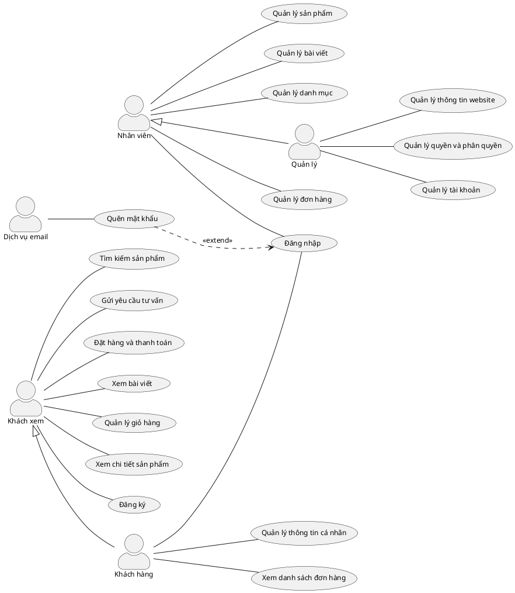
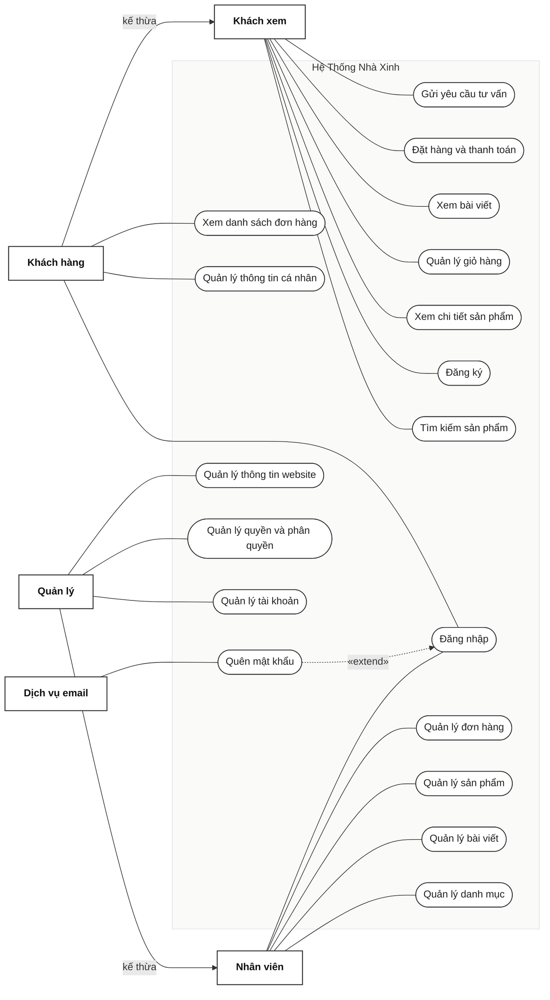

# BẢN ĐẶC TẢ VÀ SƠ ĐỒ USE CASE DỰ ÁN NHÀ XINH (CHUẨN STARUML)

> **Mô hình**: Use Case Diagram chuẩn StarUML  
> **Dự án**: Website Thương mại Điện tử Nội thất Nhà Xinh  
> **File thiết kế StarUML / PlantUML đính kèm**

---

## 1. Sơ đồ Use Case Trực quan (Chuẩn StarUML Grid)

---

## 2. Mã nguồn PlantUML (Dùng để Import / Paste trực tiếp vào StarUML)

> [!TIP]
> Bạn có thể copy đoạn mã dưới đây dán trực tiếp vào **StarUML** (thông qua menu `Tools` -> `PlantUML` hoặc plugin StarUML PlantUML) hoặc dùng trên [PlantText / PlantUML Online](https://www.planttext.com/):

---

## 3. Sơ đồ Mermaid (Hiển thị trực tiếp trong Markdown)

---

## 4. Bảng Thống kê Tác nhân và Use Case

| Nhóm | Tác nhân (Actor) | Quan hệ kế thừa | Danh sách Use Case trực tiếp |
| :--- | :--- | :--- | :--- |
| **Khách vãng lai** | `Khách xem` | Không | 1. Gửi yêu cầu tư vấn 2. Đặt hàng và thanh toán 3. Xem bài viết 4. Quản lý giỏ hàng 5. Xem chi tiết sản phẩm 6. Đăng ký 7. Tìm kiếm sản phẩm |
| **Khách hàng** | `Khách hàng` | Kế thừa từ **Khách xem** | 8. Xem danh sách đơn hàng 9. Quản lý thông tin cá nhân 10. Đăng nhập |
| **Hệ thống ngoài** | `Dịch vụ email` | Không | Gửi email liên kết xác thực đặt lại mật khẩu trong Use Case **Quên mật khẩu** |
| **Nhân viên** | `Nhân viên` | Không | 11. Quản lý đơn hàng 12. Quản lý sản phẩm 13. Quản lý bài viết 14. Quản lý danh mục 15. Đăng nhập |
| **Quản trị / Quản lý**| `Quản lý` | Kế thừa từ **Nhân viên** | 16. Quản lý thông tin website 17. Quản lý quyền và phân quyền 18. Quản lý tài khoản |

### Mối quan hệ đặc biệt (Relationships)
- **Generalization (Kế thừa)**:
  - `Khách hàng` ➔ `Khách xem`: Khách hàng sau khi đăng nhập sở hữu toàn bộ chức năng của khách xem + chức năng riêng của tài khoản.
  - `Quản lý` ➔ `Nhân viên`: Quản lý sở hữu toàn bộ chức năng quản lý nghiệp vụ bán hàng + các chức năng hệ thống cấp cao.
- **Extend (Mở rộng)**:
  - `Quên mật khẩu` **«extend»** `Đăng nhập`: Khi người dùng không nhớ mật khẩu tại màn hình đăng nhập, use case quên mật khẩu sẽ mở rộng luồng xử lý để gửi email lấy lại mật khẩu thông qua `Dịch vụ email`.
