# Thiết kế cơ sở dữ liệu website Nhà Xinh

**Công nghệ:** MySQL 8, InnoDB, `utf8mb4`; Java 17 / Spring Boot; quản lý schema
bằng Flyway.

Tài liệu này mô tả schema thương mại mục tiêu. Migration V2 gốc không còn
trong workspace; migration V1 hiện chỉ tạo hai bảng `users` và `policy_pages`
cần cho API đang có. Bản nháp V3 đang được giữ ở dạng comment và đổi phần mở
rộng `.sql.disabled`, nên Flyway không áp dụng nó khi khởi động.

## Phạm vi

| Nghiệp vụ | Bảng chính | Mục đích |
|---|---|---|
| Doanh nghiệp và chuỗi cửa hàng | `retail_chains`, `legal_entities`, `store_locations`, `warehouses`, `store_assortments`, `store_contact_points` | Một chuỗi sở hữu nhiều pháp nhân, cửa hàng/showroom, kho, assortment và điểm liên hệ |
| Nhân sự theo chi nhánh | `staff_members`, `staff_roles`, `staff_member_roles`, `store_staff_assignments` | Nhân viên có nhiều vai trò và có thể làm tại nhiều cửa hàng theo thời hạn |
| Tài khoản và quản trị | `customers`, `admin_users`, `admin_audit_logs` | Hồ sơ khách hàng, tài khoản quản trị và audit có phạm vi chuỗi/chi nhánh |
| Danh mục sản phẩm | `brands`, `categories`, `rooms`, `collections`, `products`, `product_variants`, `product_media` | Phân loại cây, nhãn hiệu, bộ sưu tập, SKU/biến thể và ảnh |
| Thuộc tính và liên kết catalog | `product_attributes`, `product_attribute_values`, `product_attribute_assignments`, `variant_attribute_assignments`, `product_categories`, `product_rooms`, `collection_products` | Lọc theo màu/chất liệu/kích thước và liên kết nhiều-nhiều với danh mục, phòng, bộ sưu tập |
| Kho | `warehouses`, `inventory_levels`, `inventory_movements` | Tồn theo SKU/kho và sổ biến động tồn |
| Mua sắm | `carts`, `cart_items`, `wishlists`, `wishlist_items`, `customer_addresses` | Giỏ khách đã đăng nhập/khách vãng lai, yêu thích và địa chỉ |
| Đơn hàng | `orders`, `order_addresses`, `order_items`, `order_status_history` | Đơn hàng, ảnh chụp địa chỉ và giá/sản phẩm tại thời điểm mua |
| Thanh toán và giao hàng | `payments`, `shipping_zones`, `shipping_zone_locations`, `shipping_methods`, `shipping_rates`, `shipments` | Giao dịch thanh toán, phí vận chuyển theo khu vực/khối lượng và theo dõi giao hàng |
| Khuyến mãi | `coupons`, `promotion_products`, `coupon_redemptions` | Mã giảm giá, sản phẩm áp dụng và lịch sử sử dụng |
| Hậu mãi | `return_requests`, `return_request_items`, `product_reviews` | Yêu cầu đổi/trả và đánh giá |
| Chăm sóc khách hàng đa kênh | `service_channel_accounts`, `customer_channel_identities`, `customer_channel_consents`, `support_conversations`, `support_messages`, `support_conversation_assignments`, `support_phone_calls`, `service_webhook_events`, `customer_service_sla_policies` | Hộp thư chung cho Facebook/Zalo/chat/email, nhật ký hotline, phân công, SLA, nhận diện khách và xử lý webhook |
| Nội dung và chăm sóc khách hàng | `policy_pages`, `hero_slides`, `blog_articles`, `design_consultations`, `newsletter_subscribers` | Chính sách, banner trang chủ, bài viết, yêu cầu tư vấn và đăng ký nhận tin |

## Quan hệ trọng tâm

```mermaid
erDiagram
    ADMIN_USERS ||--o{ INVENTORY_MOVEMENTS : records
    ADMIN_USERS ||--o{ ORDER_STATUS_HISTORY : changes
    ADMIN_USERS ||--o{ RETURN_REQUESTS : resolves
    ADMIN_USERS ||--o{ BLOG_ARTICLES : authors
    ADMIN_USERS ||--o{ ADMIN_AUDIT_LOGS : performs
    RETAIL_CHAINS ||--o{ LEGAL_ENTITIES : owns
    RETAIL_CHAINS ||--o{ STORE_LOCATIONS : operates
    LEGAL_ENTITIES ||--o{ STORE_LOCATIONS : invoices
    RETAIL_CHAINS ||--o{ WAREHOUSES : owns
    STORE_LOCATIONS o|--o{ WAREHOUSES : hosts
    STORE_LOCATIONS ||--o{ STORE_ASSORTMENTS : carries
    PRODUCTS ||--o{ STORE_ASSORTMENTS : ranged_at
    RETAIL_CHAINS ||--o{ STAFF_MEMBERS : employs
    STAFF_MEMBERS o|--o{ STORE_STAFF_ASSIGNMENTS : works_at
    STORE_LOCATIONS ||--o{ STORE_STAFF_ASSIGNMENTS : staffs
    STAFF_MEMBERS ||--o{ STAFF_MEMBER_ROLES : has
    STAFF_ROLES ||--o{ STAFF_MEMBER_ROLES : grants
    RETAIL_CHAINS ||--o{ SERVICE_CHANNEL_ACCOUNTS : connects
    STORE_LOCATIONS o|--o{ SERVICE_CHANNEL_ACCOUNTS : owns_inbox
    STORE_LOCATIONS ||--o{ STORE_CONTACT_POINTS : publishes
    RETAIL_CHAINS ||--o{ CUSTOMER_SERVICE_SLA_POLICIES : defines

    BRANDS o|--o{ PRODUCTS : labels
    CATEGORIES o|--o{ CATEGORIES : parent_of
    PRODUCTS ||--o{ PRODUCT_VARIANTS : has
    PRODUCT_ATTRIBUTES ||--o{ PRODUCT_ATTRIBUTE_VALUES : defines
    PRODUCTS ||--o{ PRODUCT_ATTRIBUTE_ASSIGNMENTS : describes
    PRODUCT_ATTRIBUTE_VALUES ||--o{ PRODUCT_ATTRIBUTE_ASSIGNMENTS : value
    PRODUCT_VARIANTS ||--o{ VARIANT_ATTRIBUTE_ASSIGNMENTS : option
    PRODUCT_ATTRIBUTE_VALUES ||--o{ VARIANT_ATTRIBUTE_ASSIGNMENTS : value
    PRODUCTS ||--o{ PRODUCT_MEDIA : displays
    PRODUCT_VARIANTS o|--o{ PRODUCT_MEDIA : variant_media
    PRODUCTS ||--o{ PRODUCT_CATEGORIES : classified_as
    CATEGORIES ||--o{ PRODUCT_CATEGORIES : contains
    PRODUCTS ||--o{ PRODUCT_ROOMS : suitable_for
    ROOMS ||--o{ PRODUCT_ROOMS : features
    COLLECTIONS ||--o{ COLLECTION_PRODUCTS : includes
    PRODUCTS ||--o{ COLLECTION_PRODUCTS : promoted_in

    PRODUCT_VARIANTS ||--o{ INVENTORY_LEVELS : stocked_as
    WAREHOUSES ||--o{ INVENTORY_LEVELS : stores
    PRODUCT_VARIANTS ||--o{ INVENTORY_MOVEMENTS : moves
    WAREHOUSES ||--o{ INVENTORY_MOVEMENTS : movement_at

    CUSTOMERS o|--o{ CUSTOMER_ADDRESSES : saves
    CUSTOMERS o|--o{ CARTS : owns
    CARTS ||--o{ CART_ITEMS : contains
    PRODUCT_VARIANTS ||--o{ CART_ITEMS : selected
    CUSTOMERS ||--o{ WISHLISTS : owns
    WISHLISTS ||--o{ WISHLIST_ITEMS : contains
    PRODUCTS ||--o{ WISHLIST_ITEMS : saved

    CUSTOMERS o|--o{ ORDERS : places
    COUPONS o|--o{ ORDERS : applied
    ORDERS ||--o{ ORDER_ADDRESSES : snapshots
    ORDERS ||--|{ ORDER_ITEMS : contains
    PRODUCTS o|--o{ ORDER_ITEMS : historical_product
    PRODUCT_VARIANTS o|--o{ ORDER_ITEMS : historical_variant
    ORDERS ||--o{ ORDER_STATUS_HISTORY : tracks
    ORDERS ||--o{ PAYMENTS : paid_by
    ORDERS ||--o{ SHIPMENTS : delivered_by
    SHIPPING_ZONES ||--o{ SHIPPING_ZONE_LOCATIONS : covers
    SHIPPING_ZONES ||--o{ SHIPPING_RATES : prices
    SHIPPING_METHODS ||--o{ SHIPPING_RATES : offers
    SHIPPING_METHODS o|--o{ SHIPMENTS : fulfills
    ORDERS ||--o{ COUPON_REDEMPTIONS : redeems
    COUPONS ||--o{ COUPON_REDEMPTIONS : used_for

    ORDERS ||--o{ RETURN_REQUESTS : returned_by
    RETURN_REQUESTS ||--|{ RETURN_REQUEST_ITEMS : requests
    ORDER_ITEMS ||--o{ RETURN_REQUEST_ITEMS : returns
    CUSTOMERS ||--o{ PRODUCT_REVIEWS : writes
    PRODUCTS ||--o{ PRODUCT_REVIEWS : receives
    ORDER_ITEMS o|--o| PRODUCT_REVIEWS : verifies

    CUSTOMERS o|--o{ DESIGN_CONSULTATIONS : requests
    ADMIN_USERS o|--o{ DESIGN_CONSULTATIONS : assigned
    STORE_LOCATIONS o|--o{ DESIGN_CONSULTATIONS : preferred_at

    CUSTOMERS o|--o{ CUSTOMER_CHANNEL_IDENTITIES : linked_channels
    SERVICE_CHANNEL_ACCOUNTS ||--o{ CUSTOMER_CHANNEL_IDENTITIES : receives_from
    CUSTOMER_CHANNEL_IDENTITIES ||--o{ CUSTOMER_CHANNEL_CONSENTS : consents
    CUSTOMERS o|--o{ SUPPORT_CONVERSATIONS : contacts
    SERVICE_CHANNEL_ACCOUNTS ||--o{ SUPPORT_CONVERSATIONS : inbox
    CUSTOMER_CHANNEL_IDENTITIES o|--o{ SUPPORT_CONVERSATIONS : external_identity
    STORE_LOCATIONS o|--o{ SUPPORT_CONVERSATIONS : routes_to
    STAFF_MEMBERS o|--o{ SUPPORT_CONVERSATIONS : assigned_agent
    ORDERS o|--o{ SUPPORT_CONVERSATIONS : about
    SUPPORT_CONVERSATIONS ||--o{ SUPPORT_MESSAGES : contains
    STAFF_MEMBERS o|--o{ SUPPORT_MESSAGES : replies
    SUPPORT_CONVERSATIONS ||--o{ SUPPORT_CONVERSATION_ASSIGNMENTS : assignment_history
    SUPPORT_CONVERSATIONS ||--o| SUPPORT_PHONE_CALLS : call_details
    SERVICE_CHANNEL_ACCOUNTS ||--o{ SERVICE_WEBHOOK_EVENTS : receives
```

In SQL the `order_addresses` table is shown as `ORDER_ADDRESSES` in the diagram
and stores one immutable shipping/billing snapshot per order and address type.

## Quyết định thiết kế

1. **SKU là đơn vị bán và tồn kho.** Giá, kích thước, biến thể và tồn kho thuộc
   `product_variants`, không ghi trực tiếp tồn kho trên `products`.
   `product_attributes`/`product_attribute_values` cung cấp thuộc tính chuẩn
   hóa để lọc theo chất liệu, màu sắc hoặc kiểu dáng; thuộc tính của sản phẩm
   và lựa chọn của từng SKU được lưu riêng.
2. **Giữ lịch sử đơn hàng.** `order_items` lưu tên, SKU, số lượng và đơn giá tại
   thời điểm mua; địa chỉ giao/nhận được chụp vào `order_addresses`. Thay đổi
   catalog hoặc hồ sơ khách không làm sai hóa đơn cũ.
3. **Tồn kho có sổ cái.** `inventory_levels` là số dư hiện tại để đọc nhanh;
   mọi nhập, xuất, giữ chỗ, hoàn/điều chỉnh phải được ghi thành
   `inventory_movements` trong cùng transaction ứng dụng.
4. **Giá dùng `DECIMAL(14,2)`, không dùng float.** Giá trị tiền trong API Java
   nên dùng `BigDecimal`. Đơn hàng giữ mã tiền tệ để hỗ trợ mở rộng về sau.
5. **Soft-state cho nội dung catalog.** Sản phẩm, danh mục, thương hiệu, bộ sưu
   tập dùng trạng thái để ẩn/ngừng bán; không xóa SKU đã được đơn hàng tham
   chiếu.
6. **Giỏ khách không lưu token thô.** API tạo token ngẫu nhiên mạnh, chỉ lưu
   SHA-256 trong `guest_token_hash`; token gốc nằm phía client trong cookie
   bảo mật.
7. **Thông tin thanh toán nhạy cảm không lưu ở đây.** `payments` lưu mã giao
   dịch, trạng thái và phản hồi đã được loại bỏ dữ liệu nhạy cảm; không lưu số
   thẻ, CVV hay bí mật cổng thanh toán.
8. **Nội dung biên tập tách khỏi dữ liệu giao dịch.** `policy_pages` hiện có,
   cùng với `hero_slides` và `blog_articles`, phục vụ CMS; dữ liệu đơn hàng và
   tồn kho không bị trộn với nội dung trang.
9. **Chuỗi cửa hàng là phạm vi dữ liệu.** `retail_chains` là gốc của cửa hàng,
   pháp nhân, kho, nhân sự và hộp thư; các khóa ngoại ghép theo `chain_id`
   ngăn phân công nhầm nhân viên hoặc inbox sang chi nhánh của chuỗi khác.
10. **CRM hợp nhất, không phụ thuộc một nhà cung cấp.** Mỗi tài khoản Facebook,
    Zalo OA, hotline, email hoặc widget chat là một `service_channel_account`.
    Hội thoại và tin nhắn dùng chung cấu trúc; `support_phone_calls` bổ sung
    metadata cuộc gọi, không lưu âm thanh trực tiếp trong MySQL.
11. **Bảo mật kênh.** `credential_secret_ref` và `recording_secret_ref` chỉ là
    tham chiếu tới secret manager/object storage; không ghi access token, khóa
    webhook hay dữ liệu thẻ vào bảng. Webhook dùng ID sự kiện duy nhất để xử lý
    idempotent và retry sự kiện lỗi.
12. **Nhân sự và cửa hàng có lịch sử phân công.** Không đặt một `store_id` cố
    định trong hồ sơ nhân viên; `store_staff_assignments` lưu chi nhánh, vai trò
    vị trí và thời gian hiệu lực để hỗ trợ nhân viên luân chuyển.

## Quy ước triển khai

- UUID/public ID có thể thêm ở API nếu không muốn lộ ID tuần tự; ID nội bộ hiện
  dùng `BIGINT AUTO_INCREMENT`.
- Mọi thao tác đặt hàng cần transaction: kiểm tra/tạm giữ tồn, tạo đơn và dòng
  đơn, lưu lịch sử trạng thái, redemption coupon; dùng khóa hàng hoặc optimistic
  locking để tránh bán vượt tồn.
- Inbox cần xử lý webhook idempotent bằng unique `(channel_account_id,
  provider_event_id)`, lưu assignment history, tính SLA theo giờ làm việc/kênh
  và kiểm tra nhân viên đang được phân công vào chi nhánh tương ứng.
- Chat trực tiếp trên website và tích hợp social cần quyền riêng tư, giới hạn
  thời gian lưu dữ liệu, xác minh chữ ký webhook và quản lý opt-in theo kênh.
- Không xóa cứng đơn hàng, payment, movement hoặc audit log. Quyền riêng tư/
  yêu cầu xóa tài khoản nên được xử lý bằng ẩn danh hóa dữ liệu cá nhân, giữ
  thông tin tài chính cần thiết theo chính sách lưu trữ.
- Phí vận chuyển được tính theo vùng, phương thức và bậc cân nặng; đồ nội thất
  cồng kềnh có thể đánh dấu cần báo giá thủ công. Phí thực tế vẫn được chụp
  vào `orders.shipping_fee` để không thay đổi đơn cũ khi biểu phí được sửa.
- Giai đoạn tiếp theo là ánh xạ schema sang entities/repositories/services/API
  theo từng module; migration này chỉ tạo nền dữ liệu, chưa tự tạo các API
  catalog, checkout, thanh toán hay quản trị kho.

## Ánh xạ với giao diện hiện tại

- `PRODUCT_GROUPS` ↔ `categories`, `BRANDS` ↔ `brands`, `ROOMS` ↔ `rooms`.
- Mỗi thẻ sản phẩm được bán qua một hoặc nhiều dòng `product_variants`.
- Bộ lọc màu/chất liệu/kích thước của trang danh mục lấy từ thuộc tính sản phẩm
  và thuộc tính SKU, không hard-code theo từng loại sản phẩm.
- Schema khởi tạo sẵn category cấp cao theo menu hiện tại, hai thương hiệu đang
  có, phòng chức năng và bộ thuộc tính mẫu chất liệu/màu sắc/phong cách/kích
  thước.
- Hero banner tĩnh trên homepage có thể chuyển sang `hero_slides` để admin quản
  trị nội dung, ảnh desktop/mobile, liên kết CTA và lịch hiển thị.
- Trang chính sách đang được lưu riêng trong `policy_pages`.
- Hotline và tài khoản Facebook/Zalo/chat được hiển thị/quản lý qua
  `store_contact_points` và `service_channel_accounts`; tất cả yêu cầu khách
  hàng có thể về `support_conversations` để CSKH phân loại và giao cho đúng
  nhân viên/cửa hàng.
- `store_locations` là showroom/cửa hàng; `warehouses` là nơi giữ hàng. Một
  cửa hàng có thể có kho phía sau, còn kho trung tâm không cần gắn với cửa hàng.
- `store_assortments` cho biết mẫu nào được trưng bày/bán tại từng chi nhánh;
  `inventory_levels` cho biết từng SKU còn bao nhiêu tại kho gắn với chi nhánh.
- Đơn có `origin_store_id` để phân biệt đơn tạo tại showroom với đơn online;
  kho thực hiện giao được xác định ở shipment.
